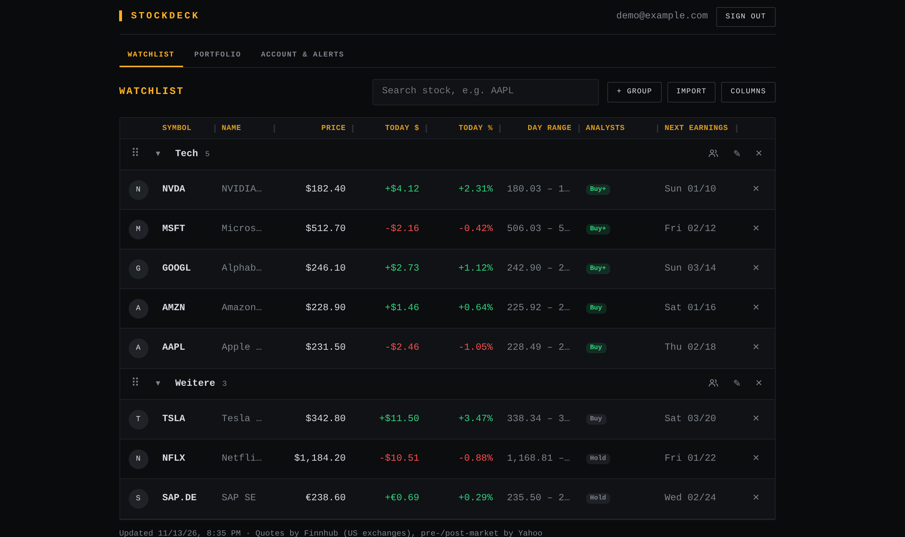
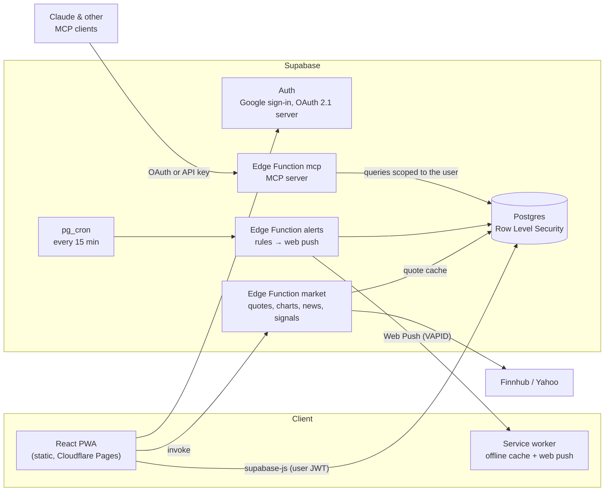
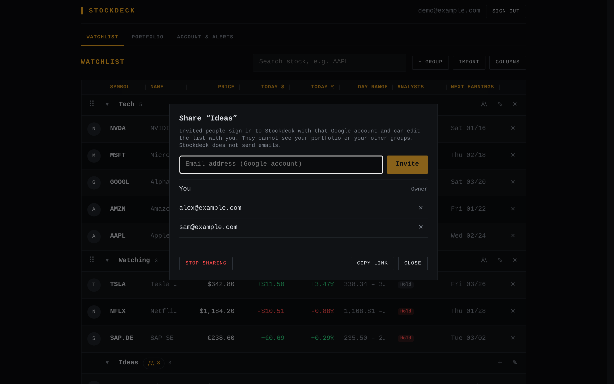

# Stockdeck

[](https://github.com/10eputzen/stockdeck/actions/workflows/ci.yml)
[](LICENSE)


A self-hosted watchlist and portfolio tracker as an installable web app (PWA): live quotes, charts, news, per-stock signals, portfolios with CSV import, web push alerts, shared watchlists and an MCP server for AI assistants.



The UI is available in English and German (browser language by default, switchable in the account settings). Translations live in `src/locales/*.json`; adding a language means adding one file.

**Stack:** React 19 + TypeScript (Vite), PWA · Supabase (Postgres with Row Level Security, Google sign-in, Edge Functions, pg_cron) · any static host (Cloudflare Pages by default) · quotes from [Finnhub](https://finnhub.io), charts and non-US symbols via Yahoo chart data.

## Features

- Watchlist with groups, drag & drop, configurable and resizable columns
- Detail view per stock: chart, key metrics, news, analyst consensus, price target, insider trades, earnings, short interest, technicals
- Portfolios with transactions, CSV import (Parqet export or a simple format), valuation in EUR
- Web push alerts: price above/below, daily move, take-profit and stop rules
- Shared watchlists: invite people by email, everyone can edit
- MCP server so Claude and other assistants can read and edit the watchlist and portfolio

## Architecture



**Design decisions**

- **No custom backend.** The frontend talks to Postgres directly; every table is protected by Row Level Security, so the database itself enforces “users only see their own data”. Fewer moving parts, nothing to keep in sync between an API layer and the schema.
- **Edge Functions only where secrets or third parties are involved.** Market data keys never reach the browser; quotes are cached in Postgres for 60 seconds so many users share one upstream call.
- **The MCP server resolves the caller first, then scopes every query.** OAuth tokens and API keys both map to a user id, only allowlisted accounts get through, and every read or write is filtered by that id.
- **Static PWA.** Installable on phone and desktop, works on any static host, push notifications without an app store.
- **Invite-only sign-up.** A `before_user_created` auth hook rejects accounts that are not on the allowlist, so a public deployment doesn't turn into an open service.

## Highlights

### MCP server: your watchlist as an AI tool

`supabase/functions/mcp/` implements the [Model Context Protocol](https://modelcontextprotocol.io) (Streamable HTTP, stateless) with 13 tools: read and edit the watchlist and groups, search symbols, get quotes, charts, news and signals, list the portfolio and record transactions.

- **Auth:** OAuth 2.1 with dynamic client registration (Supabase Auth acts as the authorization server, the app hosts the consent page), so claude.ai can connect with just the URL. Scripts and Claude Code can use an API key instead; only its SHA-256 hash is stored.
- **Only your own data:** the caller is resolved to a user id up front, and every query is filtered by it. Accounts not on the allowlist are rejected.

Example in Claude: *“Which stocks in my Tech group dropped today, and what do analysts say about them?”* Claude calls `list_watchlist`, `get_quotes` and `get_signals` and answers from your live data.

### Shared watchlists with a small permission model



- The owner invites people by email (Google account). Members can add, remove and reorder stocks; only the owner can rename, invite, remove members or stop sharing.
- Members never see the owner's portfolio or other groups. Shared lists live in their own tables with their own policies, so the private watchlist rules stay untouched.
- Invitations extend the sign-up allowlist automatically; limits (20 members, 200 stocks per list) are enforced in the database, not just in the UI.

## Project layout

- `src/` – React frontend, talks to Supabase directly (supabase-js; RLS protects the data).
- `supabase/migrations/` – schema, policies, auth hook, cron job.
- `supabase/functions/market/` – quotes (60 s cache), search, charts, news, metrics, signals; the Finnhub key stays server-side.
- `supabase/functions/alerts/` – evaluates alert rules (via pg_cron every 15 minutes) and sends web push.
- `supabase/functions/mcp/` – MCP server (Streamable HTTP, stateless) for watchlist and portfolio. Auth via OAuth (Supabase Auth as OAuth server, consent page at `/oauth/consent`) or an API key header.
- Instance values (Supabase project, app URL, VAPID key, deploy target) are not in the repo: the frontend and the deploy script read them from `.env` (template `.env.example`), the functions from their secrets (template `supabase/functions/.env.example`).

## Run your own instance

You need Node 22+, a free [Supabase](https://supabase.com) project, a [Finnhub](https://finnhub.io) API key (free tier is fine for trying it out) and a Google OAuth client for sign-in.

**1. Collect the values**

| Value | Where |
| --- | --- |
| Supabase access token and project ref | [Account → Access tokens](https://supabase.com/dashboard/account/tokens); the ref is in Project Settings → General |
| Finnhub API key | [finnhub.io/dashboard](https://finnhub.io/dashboard) |
| Google OAuth client ID and secret | Google Cloud console → APIs & Services → Credentials → OAuth client ID (type “Web application”) |

**2. Run the setup**

```bash
npm install
npm run setup
```

The script asks for the values above and your Google email, then sets up everything on the Supabase side: vault secrets, migrations, Edge Function secrets and deploy, Google sign-in, redirect URLs, the sign-up hook, the OAuth server for MCP, your account as first admin, and a `.env` for the frontend. It generates the web push (VAPID) keys itself. Running it again is safe. For an unattended run, put the values in `setup.env` (gitignored) or the environment and use `npm run setup -- --yes`; the variable names are in the header of `scripts/setup.mjs`.

**3. One manual step:** in the Google OAuth client, add `https://<project-ref>.supabase.co/auth/v1/callback` as an authorized redirect URI (the script prints the exact URL).

**4. Start the app**

```bash
npm run dev
```

Open http://localhost:5173 and sign in with Google. Invite others through shared lists.

<details>
<summary>Manual setup (what the script does)</summary>

1. Vault secrets for the cron job, in the SQL editor: `select vault.create_secret('https://<project-ref>.supabase.co', 'project_url');` and `select vault.create_secret('<random-string>', 'alerts_cron_secret');`
2. Migrations: `supabase link --project-ref <project-ref>` and `supabase db push`.
3. VAPID keys: `npx web-push generate-vapid-keys`.
4. Function secrets: copy `supabase/functions/.env.example` to `supabase/functions/.env`, fill it in, then `supabase secrets set --env-file supabase/functions/.env` and `supabase functions deploy market alerts mcp`.
5. Auth in the dashboard: enable Google (disable email sign-in), set the site URL and redirect URLs (app URL, `https://*.<your-domain>/**`, `<app-url>/oauth/consent**`), point the “Before User Created” hook to `public.hook_before_user_created`, enable the OAuth server with dynamic client registration.
6. First admin: `insert into public.allowed_emails (email, is_admin) values ('you@example.com', true);`
7. Frontend: `cp .env.example .env` and fill in the Supabase URL, publishable key, app URL and VAPID public key.

</details>

## Development

```bash
npm run lint && npx tsc -b && npm test && npm run build
```

CI runs lint, type check and tests on pull requests (`.github/workflows/ci.yml`). Run the same checks locally before pushing. Changes are listed in [CHANGELOG.md](CHANGELOG.md).

## Deploy

- **Frontend:** `npm run build` produces a static `dist/` (including `_headers` with a CSP for Cloudflare Pages). `npm run deploy` builds, checks the bundle, deploys to Cloudflare Pages and smoke-tests the live URL in a headless browser (Playwright). Values and tokens come from the environment, `.env`/`.env.deploy`, or (with `STOCKDECK_GCP_PROJECT`) from Google Cloud Secret Manager; see the header of `scripts/deploy-frontend.mjs`. Any static host works too: upload `dist/` (`_headers` is Cloudflare-specific).
- **Backend:** `npm run setup` again (applies new migrations, redeploys the functions), or `supabase db push` and `supabase functions deploy market alerts mcp`.

## AI access (MCP)

- Endpoint: `https://<project-ref>.supabase.co/functions/v1/mcp`
- claude.ai connector: add the URL; sign-in runs via OAuth through the app.
- Claude Code or other clients: header `Authorization: Bearer <key>`. To create a key, generate a random string and store only its SHA-256 hash (hex) with `user_id` and `label` in `api_keys`; revoke via `revoked_at`.

## License and data

- Code: MIT, see `LICENSE`.
- Finnhub's free tier and Yahoo chart data are for personal use only. If you run Stockdeck for other people, you need a data provider with a suitable license.
- Charts: [Lightweight Charts](https://github.com/tradingview/lightweight-charts) by TradingView (Apache 2.0).
